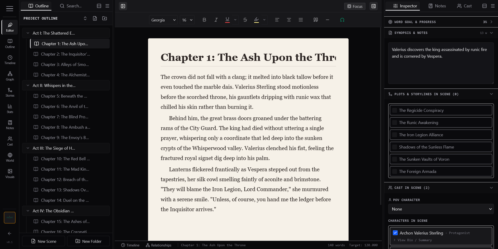

# Foliant ✍️

> An intuitive, modern writing application designed for authors to structure novels, manage characters, track timelines, and weave interconnected stories without friction.

[](https://www.gnu.org/licenses/gpl-3.0)
[](https://zintradev.github.io/foliant/)
[](https://ko-fi.com/zintradev)



---

## 🚀 Overview

Foliant is built for writers who want a clean, powerful local-first experience to organize their creative work. Whether you want to jump straight into the web version or download the native desktop app, Foliant keeps your projects structured and safe.

- **Modular Architecture:** Manage chapters, scenes, characters, locations, and timelines seamlessly.
- **Cross-Platform:** Available as a web application (via GitHub Pages) and a native desktop experience.
- **Privacy First:** Your data stays with you.

[](https://gitdiagram.com/zintradev/foliant?utm_source=readme&utm_medium=badge)

---

## 🌐 Try It Now

- **Web App:** [Access Foliant on the Web](https://zintradev.github.io/foliant/)
- **Desktop Downloads:** Get the latest installer for Windows or macOS directly from the [Releases Page](https://github.com/Zintradev/foliant/releases/latest).

---

## 🛠️ Development Setup

If you want to run or build Foliant locally from the source code, ensure you have **Node.js** installed, then follow these steps:

1. **Clone the repository:**
   ```bash
   git clone [https://github.com/Zintradev/foliant.git](https://github.com/Zintradev/foliant.git)
   cd foliant
   
2. **Install dependencies:**
    ```Bash
    npm install

3. **Run the development server:**
    ```Bash
    npm run dev

4. **Build for production:**
    ```Bash
   npm run build

## ☕ Support

If you enjoy Foliant and want to support its ongoing development, you can [buy me a coffee on Ko-fi](https://ko-fi.com/zintradev).

---

## 🤝 Contributing
Please read our [CONTRIBUTING.md](CONTRIBUTING.md) before submitting a Pull Request. We require all new code to strictly pass our quality pipeline (`npm run check-all`).

---

## 🛡️ License

This project is licensed under the **GNU General Public License v3.0 (GPL-3.0)**.

You are free to use, study, modify, and distribute this software under the terms of the GPL-3.0 license. See the [LICENSE](LICENSE) file for more details.